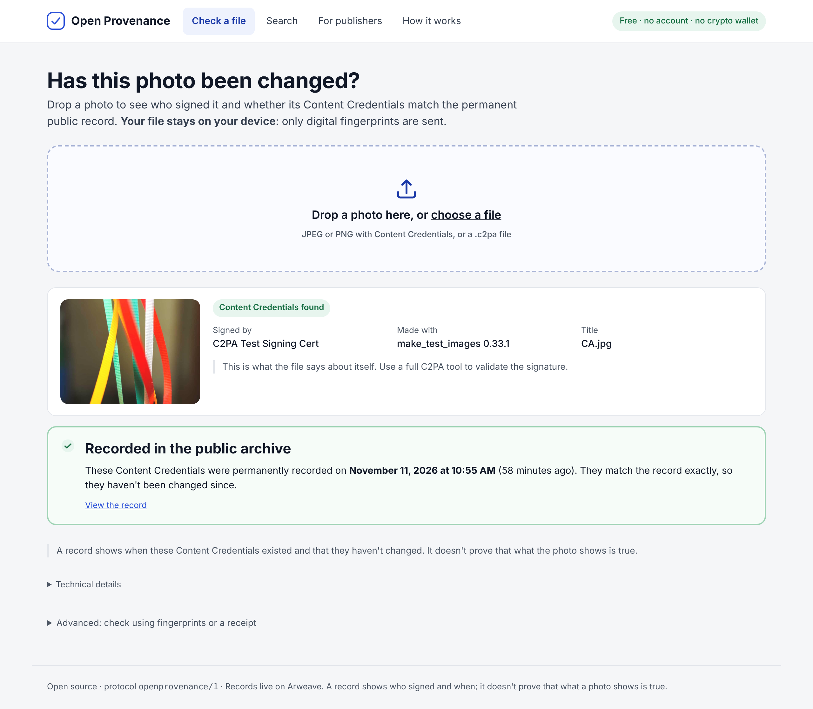
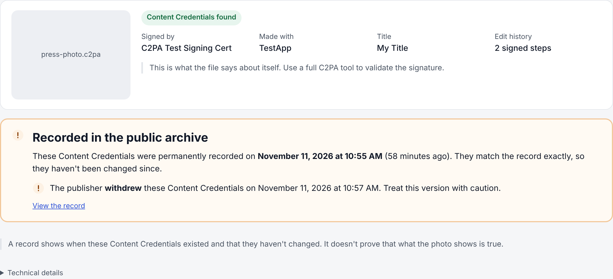
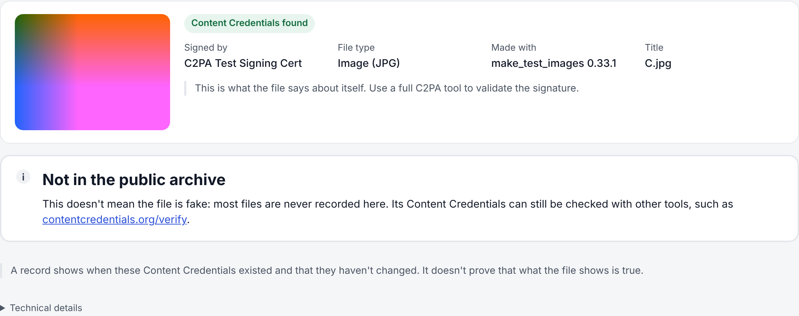
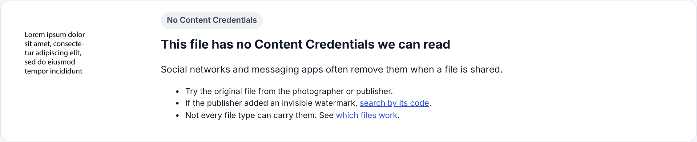
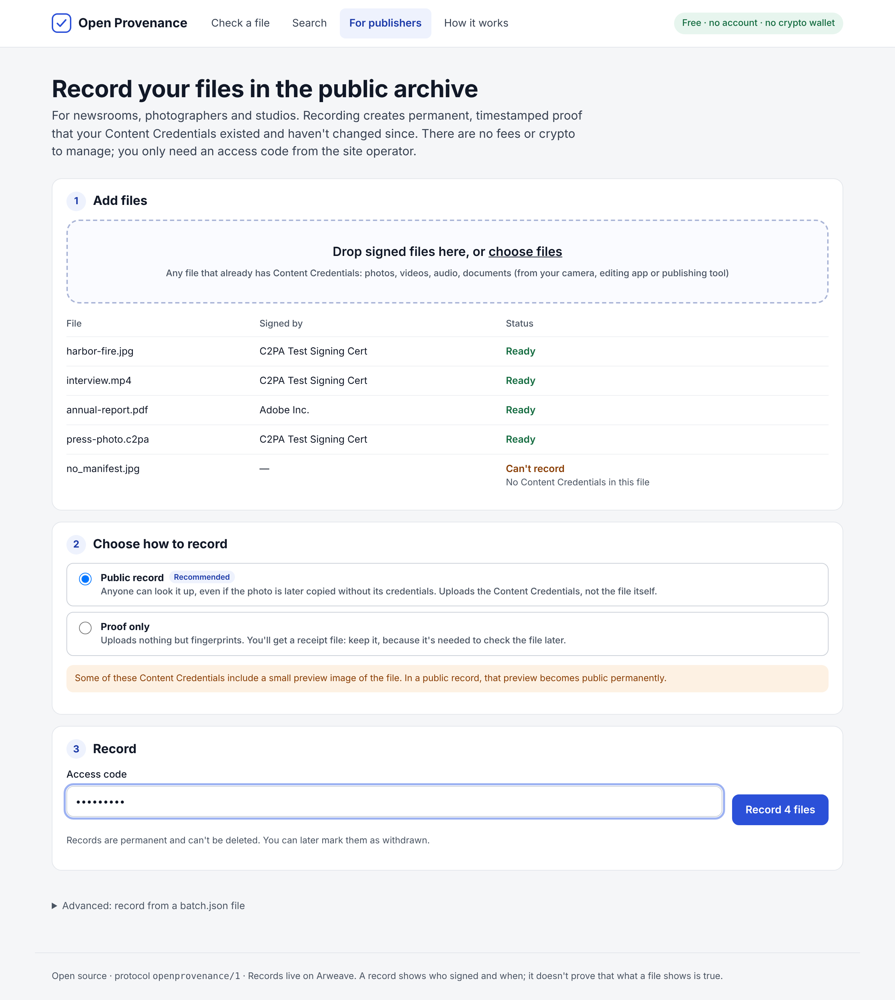
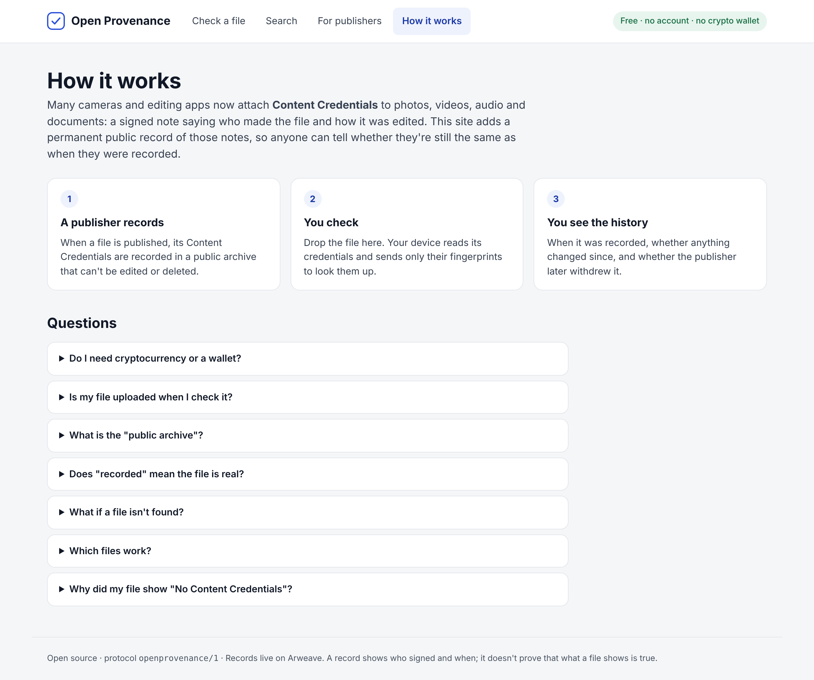
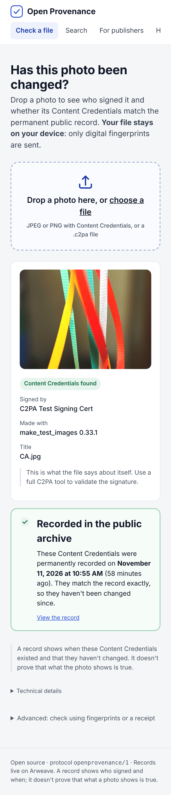

# Open Provenance on Arweave

Permanent, gas-free anchors for C2PA 2.5 Content Credentials, using only [Arweave](https://www.arweave.org). No smart contract, no gas token, no other chain.

C2PA validation is unchanged: a manifest stays valid with any C2PA validator whether or not it is on Arweave. This adds "existed no later than block N" evidence, a public lookup index and a signed status log.

| | |
| --- | --- |
| Storage and timestamps | Arweave only. Every record is an Arweave data item, mined into an Arweave block |
| Cost | No gas. Bundler mode: small uploads free, larger paid once. Direct mode: paid once in AR per byte, no third party |
| Signer keys | C2PA ES256 (P-256) keys sign statements directly |
| Web app | Cloudflare Pages: static UI + Pages Functions API, no Node compatibility flag needed |
| Tests | `npm test`: 40 tests (protocol, Web Crypto parity with Node/OpenZeppelin/arbundles/arweave-js, direct transactions, the in-browser C2PA reader on real C2PA files, Pages handlers) |
| License | Apache-2.0 |

## Screenshots

The Cloudflare Pages app, built for people who have never used crypto. You drop a photo; your browser reads its Content Credentials on your device and sends only fingerprints. Shown with the C2PA SDK's public test images, against a local Arweave simulator.

**Check a file.** Who signed it, and whether its credentials match the permanent public record.



**When the publisher has withdrawn it.** The record still matches, with a clear warning.



**Not recorded, or no credentials.** Plain explanations instead of error codes.





**For publishers.** Drop signed photos, pick public record or proof only, enter the access code. Files without credentials, or too large for a public record, are flagged before anything is sent.



**How it works,** in plain language, with answers to common questions (no wallet needed, the photo is never uploaded, what "recorded" does and doesn't prove).





The reader in `public/js/c2pa-reader.mjs` handles JPEG, PNG and `.c2pa` files with no dependencies. Tests check it against the `c2pa-ts` library on the C2PA SDK's sample files. Fingerprints, ids and the full API response stay one click away under "Technical details".

## Quick start

```bash
npm install
npx oprov wallet                                    # Arweave wallet.json (no funds needed for small uploads)
npx oprov publish batch.json                        # public: upload each manifest store
npx oprov publish batch.json --private              # private: one Merkle root for the whole batch
npx oprov status withdrawn urn:c2pa:<uuid> --key c2pa-key.pem
npx oprov verify manifest.json --signer cert.pem --tsa 1762828800
DRY_RUN=1 npx oprov publish batch.json              # no network
```

`batch.json`:

```json
[{ "urn": "urn:c2pa:3fa85f64-5717-4562-b3fc-2c963f66afa6", "storeFile": "photo.c2pa",
   "claimHash": "0x…", "signatureHash": "0x…", "bindingHash": "0x…", "signerCertHash": "0x…",
   "parents": [], "softBindings": [{ "alg": "com.example.watermark.1", "value": "0x7c3ea91f" }] }]
```

All hashes are SHA-256: of the `c2pa.claim.v2` CBOR, the `c2pa.signature` box (covers `sigTst2`), the hard-binding value and the DER signer certificate. `manifestId` = sha256 of the URN string.

## How data gets onto Arweave

Everything is stored on Arweave and only Arweave. The question is just how an upload reaches it:

| Route | What it is | Cost | Used here |
| --- | --- | --- | --- |
| Bundler (default) | A service that collects many signed data items (ANS-104 format) and posts them to Arweave as one transaction. The data items are signed by your wallet, so the bundler can't change them. | Free under the bundler's size threshold; otherwise paid once in AR, fiat or other tokens | Yes: `BUNDLER_URL`, default [ArDrive Turbo](https://docs.ar.io/build/upload/) |
| Direct transaction | A native Arweave transaction posted straight to an Arweave node (`/tx`, plus `/chunk` for data over 256 KiB). No third party in the path. | Always paid in AR, per byte, from the wallet's balance | Yes: `UPLOAD_MODE=direct`, node `ARWEAVE_NODE_URL` |

Why a bundler by default: a direct Arweave transaction always costs AR, while a bundler lets small records (most manifest stores, every anchor root and statement) go up for free. Bundling doesn't change trust: each record keeps your wallet's signature and its own Arweave id, and validators read it from Arweave gateways, not from the bundler.

Turbo is only the default. `BUNDLER_URL` accepts any ANS-104 bundler that takes signed data items over HTTP; the data items this project creates are standard and verify with the reference `arbundles` library.

Direct mode removes the bundler entirely. The wallet needs AR: before each upload it reads the price (`/price/<bytes>`) and its balance, refuses uploads above `MAX_REWARD_WINSTON`, then signs and posts the transaction. Transactions are format 2 with chunk proofs, built on Web Crypto and checked against `arweave-js` in the tests. Records are indexed and verified exactly like bundled ones.

```bash
UPLOAD_MODE=direct MAX_REWARD_WINSTON=100000000000 npx oprov publish batch.json   # CLI, signs with wallet.json
```

In Cloudflare, set `UPLOAD_MODE = "direct"` and raise `MAX_STORE_BYTES` if you want to accept larger stores.

## Cloudflare Pages

The repo is a ready Pages project: `public/` is the site (Verify, Lookup, Publish), `functions/api/` is the API. Everything in the request path uses Web Crypto, so it runs on the Workers runtime as-is, including signing ANS-104 data items for upload.

```bash
npm install
npx oprov wallet --out wallet.json                         # publisher wallet (no funds needed for small uploads)
npx wrangler pages project create openprovenance
npx wrangler pages secret put ARWEAVE_JWK   --project-name openprovenance < wallet.json
npx wrangler pages secret put PUBLISH_TOKEN --project-name openprovenance # a long random string
npm run deploy
```

Or connect the Git repo in the Cloudflare dashboard: no build command, output directory `public`. Settings live in `wrangler.toml`; set the same secrets under Settings → Variables and Secrets.

| Endpoint | Auth | Purpose |
| --- | --- | --- |
| `GET /api/health` | none | Protocol, gateways, publisher address |
| `POST /api/verify` | none, CORS on | `{ manifest, receipt?, storeSha256? or storeBase64?, signerCertPem?, tsaTime?, trustedUploaders? }` → result codes, checked across every gateway in `GATEWAYS` |
| `GET /api/find?by=urn\|manifest\|store\|softbinding\|root&value=…[&alg=…]` | none, CORS on | Tag lookup on Arweave |
| `POST /api/publish` | `Authorization: Bearer <PUBLISH_TOKEN>` | `mode: "public"` (stores, base64), `"private"` (hash root) or `"statement"` (pre-signed with the C2PA key; delegate-posted statements must come from the delegate's own wallet) |

| Variable | Default | Notes |
| --- | --- | --- |
| `GATEWAYS` | `https://arweave.net` | Comma-separated. Add a second, independent gateway: results are compared and disagreement is reported |
| `UPLOAD_MODE` | `bundler` | `bundler` (free for small records) or `direct` (native Arweave transactions, paid in AR) |
| `BUNDLER_URL` | `https://upload.ardrive.io` | Bundler mode: where signed uploads are sent on their way to Arweave. ArDrive Turbo by default; any compatible ANS-104 bundler works |
| `ARWEAVE_NODE_URL` | `https://arweave.net` | Direct mode: the Arweave node or gateway that accepts `/tx` and `/chunk` |
| `MAX_REWARD_WINSTON` | `100000000000` (0.1 AR) | Direct mode: spending cap per upload; over it, `/api/publish` answers 402 |
| `MAX_STORE_BYTES` | `102400` | Largest store `/api/publish` accepts. Keep it under the bundler's free size to stay at zero cost |
| `TRUSTED_UPLOADERS` | empty | Default trusted publisher addresses for `/api/verify` |
| `ARWEAVE_JWK` (secret) | — | Publisher wallet. Without it, publishing is off and the site is verify-only |
| `PUBLISH_TOKEN` (secret) | — | Bearer token for `/api/publish` |

Local development: copy `.dev.vars.example` to `.dev.vars`, then `npm run dev`. For an offline run, start `npm run dev:fake-arweave` (a local gateway, bundler and node that check every signature) and point `GATEWAYS`, `BUNDLER_URL` and `ARWEAVE_NODE_URL` at `http://127.0.0.1:9000` in `.dev.vars`; `curl 127.0.0.1:9000/__mine` mines pending uploads.

The browser never sees the publisher wallet. Producers sign statements offline with their C2PA key (`oprov` or `createStatement`), and the API refuses anything a validator would ignore.

## Protocol `openprovenance/1`

### Records

Every record is an Arweave data item tagged `App-Name: OpenProvenance`, `App-Version: 2`, `Type`, `Content-Type`.

| Type | Body | Tags | Purpose |
| --- | --- | --- | --- |
| `manifest-store` | the full JUMBF manifest store, byte-for-byte as embedded (`application/c2pa`) | `C2PA-Manifest-URN`, `C2PA-Manifest-Id`, `C2PA-Claim-Hash`, `C2PA-Signature-Hash`, `C2PA-Binding-Hash`, `C2PA-Signer-Cert-Hash`, `Store-SHA256`, `C2PA-Parent`*, `Soft-Binding-Key`* | Public mode: the store is its own anchor and a repository copy (`ar://<id>` for `dcterms:provenance` / `hashed_ext_uri`) |
| `anchor-root` | `{ protocol, root, count }` | `Merkle-Root`, `Count` | Private mode: one record for a whole batch; stores stay private |
| `anchor-tree` | OpenZeppelin `StandardMerkleTree` dump | `Merkle-Root` | Optional: publish the leaves behind a root |
| `statement` | `{ payload, signature? }` (below) | `Statement-Type`, `Signer-Key-Id`, `Subject` | Signer delegation, revocation, manifest status |

\* repeated once per value. `Soft-Binding-Key` = sha256(alg ‖ 0x00 ‖ value).

Private-mode leaves are `keccak256(keccak256(abi.encode(manifestId, claimHash, signatureHash, bindingHash, signerCertHash, storeUri, parents)))`, pairs hashed sorted (OpenZeppelin-compatible, so any Merkle library can check proofs).

### Statements

`payload` is a JSON string `{ protocol: "openprovenance/1", type, keyId, issuedAt, … }`. `signature` = `{ alg: "ES256", x, y, sig }`, an ES256 signature over the exact payload bytes. `keyId` = sha256(0x04 ‖ x ‖ y), the uncompressed point as found in the certificate.

| Kind | Fields | Who may post |
| --- | --- | --- |
| `delegate` | `delegate` (Arweave address), `active` | Key-signed only |
| `revoke` | `reasonUri` | Key-signed only |
| `manifest-status` | `manifestId`, `status` (`superseded` / `withdrawn`), `reasonUri` | Key-signed, or unsigned from an active delegate's Arweave address |

### Read-time rules (replace a smart contract)

Every validator applies these in the same way:

1. Only mined records count. Pending ones are reported, never applied.
2. Order: block height, then `issuedAt`, then data item id.
3. The first valid `revoke` is final. Delegations stop counting from that point.
4. A delegate counts only for statements in blocks strictly after the delegation.
5. Manifest status only moves forward: none → superseded → withdrawn. The key itself may still post it after revocation.
6. Statements with a bad signature, a key that doesn't match `keyId`, or tags that don't match the payload are ignored.

### Validation result codes

Reported separately from, and never changing, the C2PA validation state.

| Code (`org.openprovenance.*`) | Meaning |
| --- | --- |
| `anchor.match` | A mined record matches the manifest (and the exact store, if given) |
| `anchor.pending` | Found, but not yet mined: no timestamp proof yet |
| `anchor.missing` | Nothing found (informational) |
| `anchor.mismatch` | A trusted publisher's record, a receipt or stored bytes disagree |
| `time.inconsistent` | Anchored before its own TSA time stamp (beyond a 2-hour tolerance) |
| `store.unavailable` | The record exists but its bytes could not be fetched |
| `signer.revoked` | The signer key was revoked (with time, and whether after the claim) |
| `manifest.superseded`, `manifest.withdrawn` | The author changed the manifest's status |

## Trust notes

- Anyone can upload anything with any tags. Records are evidence only after the validator checks hashes, signatures and, ideally, the uploader address (`TRUSTED_UPLOADERS`).
- Read through two independent gateways and compare; one gateway alone is a single point of trust.
- A bundler makes data readable immediately, but the timestamp proof exists once its bundle is mined into an Arweave block.
- A bundler's free tier is that bundler's policy, not an Arweave rule. Budget for paid uploads of larger stores.
- The uploader wallet signs data items; keep it separate from C2PA signing keys.
- `/api/publish` uses one shared wallet and one token. For several producers, put Cloudflare Access in front of it or issue per-producer deployments.
